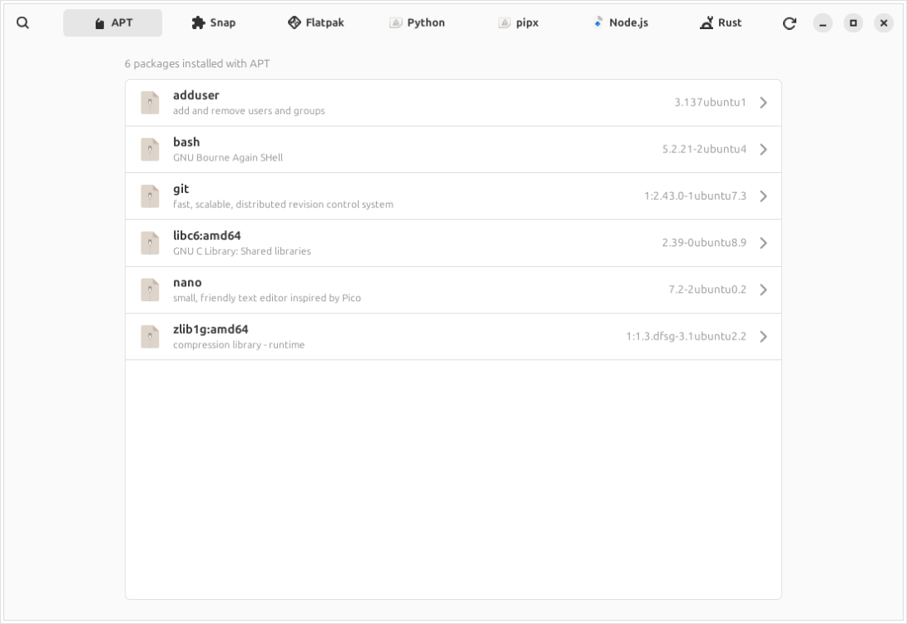
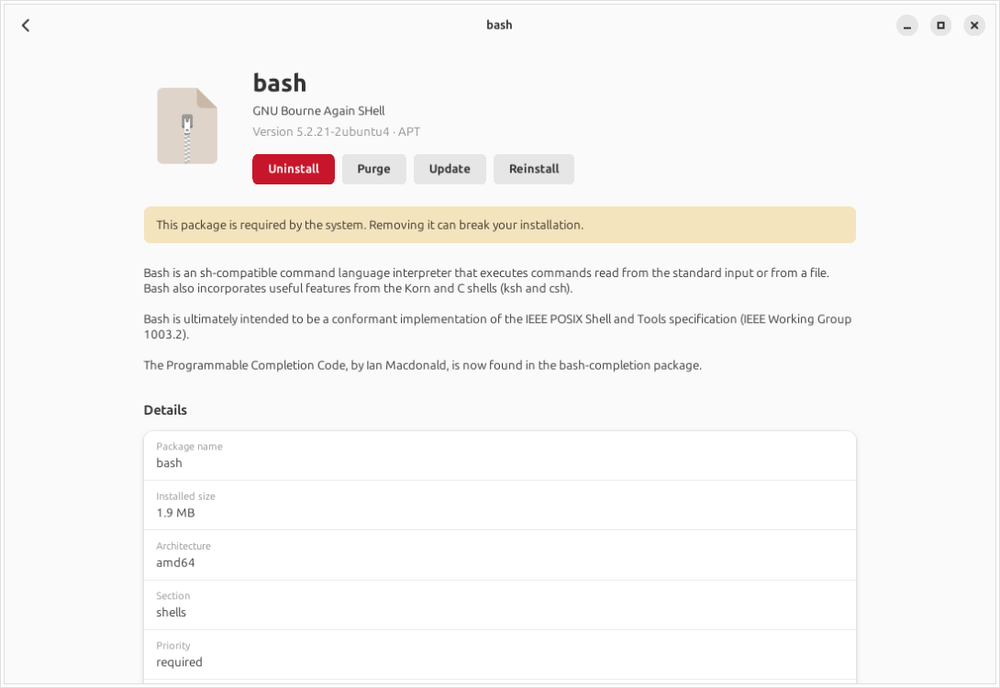
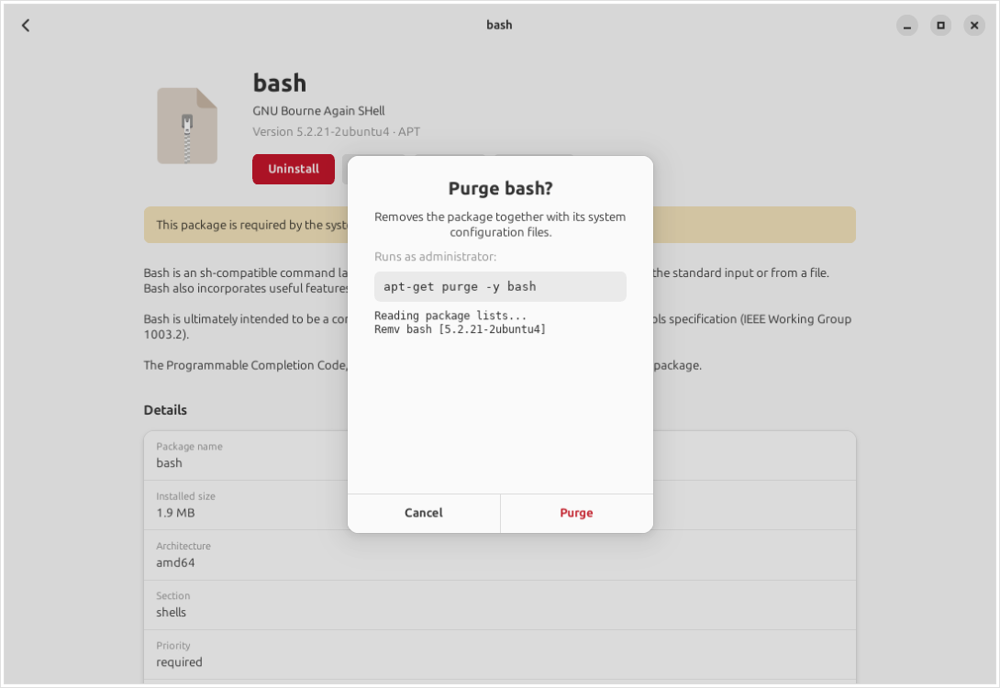

# DepMan

**One window for every package manager on your Linux system.**

Linux software comes from many places at once: the distribution's own packages, Snap, Flatpak,
`pip`, `npm`, `cargo`. Finding out what is installed, where it lives and how to get rid of it
means remembering a different command for each. DepMan puts all of them in one simple window.



## What it does

- **Finds your package managers.** Each one that is installed and working gets its own tab.
- **Lists everything each manager installed**, with version and a one-line summary.
- **Searches every tab at once.** Just start typing.
- **Gives every package its own page**: version, description, size, license, homepage,
  dependencies, the folders its files live in and the full file list.
- **Uninstall, purge, update or reinstall** with one button.
- **Shows the exact command before running it.** Where the manager supports it, you also see a
  dry run of what else would be removed. Nothing runs until you confirm.
- **Asks for your password only when needed**, through the normal system dialog.

| Package page | Confirmation |
|---|---|
|  |  |

## Supported package managers

| Tab | Covers | Actions |
|---|---|---|
| APT | Debian, Ubuntu, Mint, Pop!\_OS | Uninstall, Purge, Update, Reinstall |
| Pacman | Arch, Manjaro, EndeavourOS | Uninstall, Purge, Reinstall |
| DNF | Fedora, RHEL, CentOS Stream, Rocky, Alma | Uninstall, Update, Reinstall |
| Zypper | openSUSE | Uninstall, Purge, Update, Reinstall |
| Snap | snaps | Uninstall, Purge, Update |
| Flatpak | system and per-user flatpaks | Uninstall, Purge, Update |
| Python | global and `--user` packages | Uninstall, Update |
| pipx | pipx applications | Uninstall, Update, Reinstall |
| Node.js | `npm -g` packages | Uninstall, Update |
| Rust | `cargo install` binaries | Uninstall, Update |

"Purge" means "remove and also delete what a plain uninstall leaves behind": configuration
files for APT and Pacman, saved data for Snap and Flatpak, unneeded dependencies for Zypper.

Python packages that belong to your distribution (for example `python3-requests` from APT)
are shown read-only in the Python tab, with a pointer to the tab that owns them, so `pip`
never fights your system package manager.

## Requirements

- Python 3.12 or newer
- GTK 4 and libadwaita 1.5 or newer, with the Python GObject bindings
- polkit (`pkexec`) for actions that need administrator rights

That means Ubuntu 24.04+, Debian 13+, Fedora 40+, openSUSE Tumbleweed, Arch and other
current distributions. DepMan has no other dependencies.

## Install

First install the requirements with your distribution's package manager:

| Distribution | Command |
|---|---|
| Ubuntu / Debian | `sudo apt install python3-gi gir1.2-gtk-4.0 gir1.2-adw-1 make git` |
| Fedora | `sudo dnf install python3-gobject gobject-introspection gtk4 libadwaita make git` |
| Arch | `sudo pacman -S python-gobject gtk4 libadwaita make git` |
| openSUSE | `sudo zypper install python3-gobject typelib-1_0-Gtk-4_0 typelib-1_0-Adw-1 make git` (package names not yet verified) |

Then install DepMan. This works the same on every distribution:

```sh
git clone https://github.com/YasharSL/Depman.git
cd Depman
sudo make install
```

Start it with `depman` or pick **DepMan** from your application menu.
Remove it again with `sudo make uninstall`.

To try it without installing anything, run `python3 -m depman` inside the cloned folder.

### Native packages

If you prefer a package your system's package manager tracks:

- **Debian / Ubuntu:** `make deb`, then `sudo apt install ./dist/depman_0.1.0_all.deb`
- **Arch:** `cd packaging/arch && makepkg -si`
- **Fedora:** build `packaging/fedora/depman.spec` with `rpmbuild`

The Arch and Fedora recipes download the `v0.1.0` release from GitHub. Publishing to a PPA or
your own apt repository is described in [docs/distributing.md](docs/distributing.md).

## Safety

- Every action shows its exact command and waits for you to confirm.
- APT and Pacman also show a dry run listing everything that would be removed.
- Packages your system needs to boot carry a warning on their page.
- DepMan never runs a shell string; commands are passed as plain argument lists.
- Privileged commands go through `pkexec`, so your password is handled by your desktop,
  never by DepMan.

Removing packages is still your decision. DepMan makes it easy to see what a command will do;
it cannot stop you from removing something you need.

## Development

```sh
sudo apt install python3-pytest xvfb make && pipx install ruff   # or your distro's equivalent
make check        # format, lint, import layering, file-length ratchet, tests
make screenshot   # renders the UI on test data into build/screenshots/
```

The code is small and split so that each package manager is one self-contained module:

```
depman/core/       shared models, the Runner (the only code that executes commands), registry
depman/managers/   one module per package manager: its commands, parsing and actions
depman/ui/         the GTK 4 / libadwaita interface; knows nothing about any specific manager
tests/             every manager is tested against recorded real command output
coding-guide/      the project's coding rules and the scripts that enforce them
```

To add a package manager, add one module to `depman/managers/`, register it in
`depman/core/registry.py` and add tests. The UI needs no change.

## License

[MIT](LICENSE) © 2026 YSLdev
